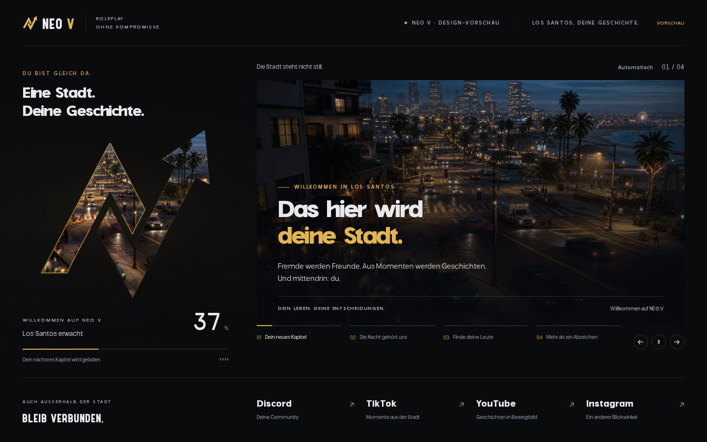

# NEO V Loading Screen

Filmischer FiveM-Loadingscreen in der NEO V-Identität. Original-Logo, Originalschriften und Bilder aus `neov-homepage`, lokal ausgeliefert und ohne Build oder CDN.



## Vorschau

Im Projektordner:

```sh
python3 -m http.server 4173 --bind 127.0.0.1
```

**http://127.0.0.1:4173/html/?preview=1**

Die Vorschau startet mit 37 % und simuliert den Fortschritt bis 94 %. Sie ist nur auf localhost, 127.0.0.1 oder bei lokal geöffneten Dateien aktiv. Ohne Parameter wartet der Screen auf echte FiveM-Nachrichten. Zum zuverlässigen Testen den HTTP-Server verwenden.

## Installation

1. Diesen Ordner als `fivem-loading-screen` in `resources` kopieren.
2. In `server.cfg` eintragen:

```cfg
ensure fivem-loading-screen
setr sv_showBusySpinnerOnLoadingScreen false
```

3. Resource neu starten und neu verbinden. Der Loadingscreen erscheint beim Verbinden.

`fxmanifest.lua` liefert HTML, CSS, JavaScript, Fonts und alle Dateien unter `html/media/` aus. Der Cursor ist aktiviert. Das Original-Logo ist als SVG-Kontur im HTML und als SVG-Daten-URI in `html/css/brand.css` eingebettet: Die bestehende Absicherung gegen fehlende Logo-Dateien bleibt erhalten. Neue Bilder und Videos werden regulär als Resource-Dateien ausgeliefert; das muss beim ersten Server-Test mit geprüft werden.

## Inhalte pflegen

Alles in **`html/js/config.js`**. Die mitgelieferten Event- und Fraktionstexte sind gekennzeichnete Beispielinhalte, keine aktuellen Ankündigungen. Es gibt keine CMS-Anbindung; Änderungen an dieser Datei werden mit der Resource ausgeliefert.

### News und Events

`stories` enthält die Meldungen in ihrer Reihenfolge. Drei bis fünf Meldungen funktionieren besonders gut. Eine leere Liste zeigt eine allgemeine Willkommensmeldung.

```js
{
  category: 'COMMUNITY EVENT',
  label: 'Car Meet am Pier',
  title: ['Dein Wagen.', 'Dein Abend.'],
  description: 'Bring deinen Wagen zum Pier und lerne die Menschen hinter den Lenkrädern kennen.',
  image: 'media/events/car-meet.webp',
  imageAlt: 'Fahrzeuge beim Treffen am Pier',
  icon: 'media/icons/calendar.svg',
  logo: 'media/brands/workshop.png',
  logoAlt: 'Logo der veranstaltenden Werkstatt',
  meta: 'ORT UND TERMIN EURES EVENTS',
  footnote: 'Weitere Infos im Discord'
}
```

Die Pfade sind relativ zu `html/index.html`. `icon` und `logo` sind optional. Logos möglichst mit transparentem Hintergrund. Bilder idealerweise mindestens 1600 × 1000 Pixel, mit dem Motiv in der oberen Hälfte; unten liegt die Typografie. Kurze Titel verwenden, maximal zwei Zeilen vorsehen. Lange Inhalte auf der Vorschau prüfen.

`slideDuration` bestimmt die Lesedauer in Millisekunden. Mindestwert: 4000. Standard: 10000. Auswahl über die Vorschauleiste, Pfeiltasten oder Pfeilbuttons. Der Pausebutton stoppt den automatischen Wechsel; der Zustand steht sichtbar neben dem Zähler. Maus-Hover und Mausklick-Fokus halten die Rotation nicht an. Eine manuelle Auswahl startet die volle Lesedauer neu. Tastaturfokus pausiert explizit; der Playbutton setzt auch bei bestehendem Fokus fort. Leertaste pausiert, wenn kein Bedienelement fokussiert ist. Bereits durchlaufene Segmente bleiben gedimmt gefüllt, beim Umlauf werden sie zurückgesetzt.

### Das Logo als Video-Canvas

```js
portal: {
  image: 'media/life-city.jpg',
  video: 'media/city-reel.webm'
}
```

Ein lokales WebM oder MP4 wird lautlos, in Schleife und innerhalb der Original-Logoform abgespielt. Ohne Video bewegt sich das Bild mit einer langsamen Kamerafahrt. Das Poster bleibt bei Videofehlern oder blockiertem Autoplay sichtbar. Ein passendes Video ist noch nicht enthalten. Für die Auslieferung kurze, komprimierte Clips verwenden.

### In-Game-Logos

Logos gehören direkt zur jeweiligen Meldung: `stories[].logo` und `logoAlt` zeigen etwa das Emblem einer Werkstatt, Fraktion oder eines Veranstalters oben rechts auf der Bildbühne. `stories[].icon` ist der kleinere Rubrik-Marker. Die separate Footer-Rotation, ihre Demonstrationslogos und Tipps sind entfernt; `showcase`, `showcaseDuration` und `tips` werden nicht mehr verwendet.

## Social Media

`socials` in `html/js/config.js` konfiguriert die kompakte, statische Leiste unter dem Carousel. Discord, TikTok, YouTube und Instagram sind mit `url: '#'` als Platzhalter eingetragen. Diese Links springen nicht zum Seitenanfang und öffnen keinen leeren Tab. Einfach durch eure HTTPS-Kanaladressen ersetzen; echte Ziele öffnen sich in einem neuen Tab.

```js
socials: [
  { label: 'Discord', description: 'Deine Community', url: '#' },
  { label: 'TikTok', description: 'Momente aus der Stadt', url: '#' },
  { label: 'YouTube', description: 'Geschichten in Bewegtbild', url: '#' },
  { label: 'Instagram', description: 'Ein anderer Blickwinkel', url: '#' }
]
```

`socials: []` blendet die Leiste aus. Leere oder ungültige Ziele erscheinen nur in der Design-Vorschau als nicht klickbare Einträge. Auf Desktop reserviert die Leiste 100–150 Pixel Höhe; mobil werden die Kanäle in zwei Spalten angezeigt.

## Fontdisziplin und Bewegung

Die Schriftrollen folgen `fivem-corerp/docs/mockups/fonts/fontkonzept.html` und sind zentral in `html/css/style.css` definiert:

- `--font-display`: Ignazio 400 für die kurze feste Marke. Keine synthetische Fettschrift.
- `--font-display-soft`: Corvent 700 für variable Satzüberschriften.
- `--font-ui`: Helvena 400/500 für Lesetext und Bedienung.
- `--font-meta`: Corvent 500 für Rubriken und Status, optisch größer kalibriert.
- `--font-num`: Codent 400 für laufende Prozentwerte und den Meldungszähler.

Keine Terminal-Schrift im UI; Thegora und Outline werden nicht ohne passende Rolle eingesetzt. `font-synthesis: none` verhindert gefälschte Schnitte.

Beim Meldungswechsel öffnet ein gerichteter diagonaler Reveal das nächste Bild. Das vorige Bild verschiebt sich leicht in Gegenrichtung; Titelzeilen kommen versetzt aus eigenen Masken. Die Logo-Bühne wird einmal beim Einstieg freigelegt. Schnelle weitere Eingaben brechen laufende Übergänge ab. Reduzierte Bewegung deaktiviert die CSS- und JavaScript-Effekte. Eine statische Social-Leiste unter der Hauptfläche begrenzt die Höhe des Carousels; sie besitzt keine eigene Rotation.

## Ladefortschritt und Übergang

- `loadProgress` zeichnet die Originalkontur proportional zur tatsächlichen Länge beider SVG-Pfade nach und aktualisiert Prozentanzeige und Linie.
- Ungültige Werte werden ignoriert, gültige auf 0–100 % begrenzt. Der Fortschritt läuft nicht rückwärts.
- Native Ladeereignisse aktualisieren den Statustext. 100 % allein beendet den Screen nicht.
- Das vorhandene `client.lua` wartet auf `NetworkIsPlayerActive`, sendet `shutdownLoadingScreen` und schließt die NUI. Das HTML blendet in 600 ms aus und sendet einmalig den NUI-Callback. Der Lua-Fallback greift nach 1000 ms.
- Wenn eure Charakterauswahl einen anderen Bereitschaftszeitpunkt benötigt, muss der Trigger in `client.lua` an diesen Ablauf gekoppelt werden.

API-Grundlage: [Cfx-Dokumentation zu Loading Screens](https://docs.fivem.net/docs/scripting-manual/nui-development/loading-screens/).

## Darstellung und Barrierefreiheit

Desktop: linkes Drittel für Marke und Laden, rechte zwei Drittel für Meldungen. Auf schmalen Bildschirmen stapeln sich die Flächen. Ultrawide wird bis 2560 Pixel Inhaltsbreite unterstützt. Reduzierte Animationen deaktivieren Kamerafahrten und initial die automatische Rotation; manuelle Navigation bleibt möglich. Versteckte Browser-Tabs pausieren Rendering und Video. Sichtbarer Tastaturfokus und semantischer Fortschrittsbalken sind enthalten.

## Browserprüfung

`tests/browser.cjs` prüft sechs Bildschirmgrößen, alle Beispielmeldungen, fehlende Medien, leere Konfiguration, Schriftrollen, Tastatur, Pause/Fortsetzen mit verbleibendem Mausfokus, automatischen Wechsel mit Hover, Timer-Neustart, vollständigen Umlauf, schnelle Mehrfachwechsel, reduzierte Bewegung, Ladeereignisse und einmaligen Shutdown. Der Vorschau-Server muss laufen.

Mit einer vorhandenen Playwright-Installation:

```sh
node tests/browser.cjs
```

Alternativ den Modulpfad und optional den Browserpfad angeben:

```sh
PLAYWRIGHT_MODULE=/pfad/zu/playwright CHROMIUM_PATH=/pfad/zu/chromium node tests/browser.cjs
```

Screenshots landen unter `/tmp/neov-<breite>.png`. `TEST_URL` kann eine andere lokale Vorschau-Adresse setzen. Ein echter FiveM-Join, Resource-Download und Übergang zur Charakterauswahl müssen zusätzlich im Spiel geprüft werden.
